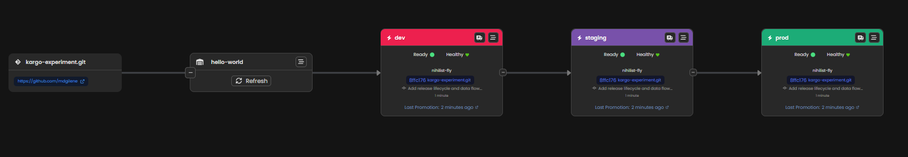
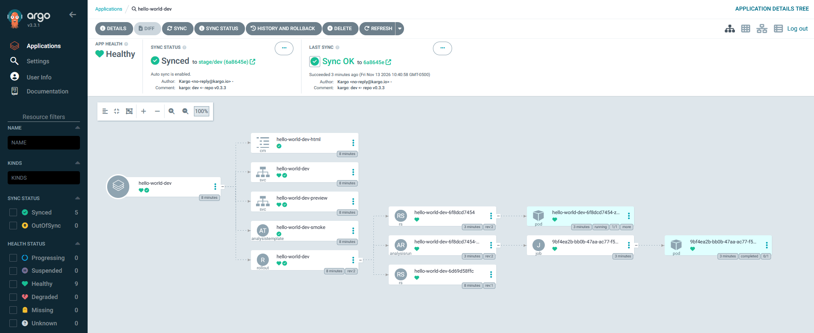

# Kargo Release Orchestration Research

Kargo + Argo CD + Helm, using an **app-of-apps** layout. Everything in this repo is versioned
together with semver git tags (`vX.Y.Z`); a tag is the unit Kargo promotes.




## Layout (on `main`)

| Path | Purpose |
|---|---|
| `charts/hello-world`, `charts/hello-api` | Helm charts (Argo Rollouts blue/green, smoke test as pre-promotion analysis) |
| `stages/<env>/<app>.yaml` | Per-environment Helm values for each app |
| `apps/<env>/<app>.yaml` | Child Argo CD `Application` manifests for that environment |
| `argocd/root-<env>.yaml` | Root (app-of-apps) Application per environment; apply once with `kubectl` |
| `kargo/` | Kargo `Project`, `Warehouse`, `Stage`s and the E2E `AnalysisTemplate`s |

## How a release flows

1. Tag the repo with a release candidate (`git tag -a vX.Y.Z-rc.1`, bump `version` in both `Chart.yaml` files) and push.
2. The `hello-world` Warehouse creates RC Freight; `dev` auto-promotes, then `staging`.
3. Each stage builds its `stage/<env>` branch from the tagged commit: `charts/`, `values/`, `apps/`.
4. `root-<env>` (tracking `stage/<env>`) deploys the child apps; Kargo syncs the root, then each child.
5. `staging` runs the E2E suites (`kargo/analysis-e2e*.yaml`) as Kargo verification.
6. Once `staging` passes, the `release` stage promotes `vX.Y.Z-rc.N` to `vX.Y.Z`, which `hello-world-releases` picks up to auto-promote `prod`.

## Ports (kind)

`hello-world` is exposed on NodePorts 32080 (dev), 32081 (staging), 32082 (prod).
`hello-api` is ClusterIP only; use `kubectl port-forward`.

## Bootstrap from Scratch

Requires `docker`, `kind`, `kubectl`, and `helm`:

```bash
# Create kind cluster + install cert-manager, Argo CD, Argo Rollouts, Kargo, and this repo
GITHUB_USER=<user> GITHUB_TOKEN=<pat-with-repo-scope> make bootstrap
```

Run `make help` for individual targets (`cluster`, `kargo`, `argocd`, `project`, `apps`, `status`, `teardown`).

## Documentation

- [Release Lifecycle & Data Flow](docs/architecture.md) — Detailed walkthrough of `main` vs. `stage/*` branches, Kargo Freight/Promotions, Argo CD App-of-Apps, Blue/Green Rollouts, and Smoke/E2E verification.
