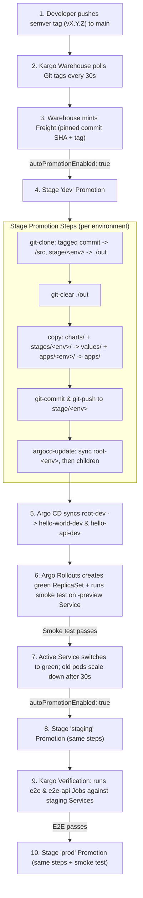

# Release Lifecycle & Data Flow

This document explains how **Kargo**, **Argo CD**, **Argo Rollouts**, and **Helm** work together in this repository to orchestrate releases across `dev`, `staging`, and `prod`.

---

## 1. Core Design: `main` vs. `stage/<env>` Branches

This setup separates **source configuration** from **environment state** using Git branches in the same repository:

- **`main` branch (human-managed source of truth):**
  - `charts/<app>/` — Helm charts (`hello-world`, `hello-api`).
  - `stages/<env>/<app>.yaml` — Environment-specific Helm values.
  - `apps/<env>/<app>.yaml` — Child Argo CD `Application` manifests per environment.
  - `argocd/root-<env>.yaml` — Root Argo CD `Application`s (App-of-Apps), applied once during bootstrap.
  - `kargo/` — Kargo `Project`, `ProjectConfig`, `Warehouse`, `Stage`s, and E2E `AnalysisTemplate`s.
- **`stage/dev`, `stage/staging`, `stage/prod` branches (Kargo-managed):**
  - Never edited manually.
  - Each promotion replaces the contents of `stage/<env>` with a self-contained snapshot assembled from the promoted Git tag (`charts/`, `values/`, and `apps/`).
  - Argo CD only reads from `stage/<env>` branches.

---

## 2. End-to-End Flow

---

## 3. Step-by-Step Lifecycle

### Step 1: Release Creation (`main` + SemVer Tag)
A release is triggered by bumping `version` in `charts/hello-world/Chart.yaml` and `charts/hello-api/Chart.yaml`, committing to `main`, and pushing an annotated SemVer tag (`vX.Y.Z`). Both applications are versioned and promoted together as a single unit.

### Step 2: Artifact Discovery (`Warehouse` → `Freight`)
- `kargo/warehouse.yaml` defines the `hello-world` `Warehouse` with `interval: 30s`.
- It subscribes to Git tags on `https://github.com/mdgilene/kargo-experiment.git` using `commitSelectionStrategy: SemVer` (`>=0.1.0`).
- When a new tag appears, Kargo creates a **Freight** resource containing the exact commit SHA and tag name.

### Step 3: Stage Promotion (`PromotionTemplate`)
`kargo/project.yaml` (`ProjectConfig`) sets `autoPromotionEnabled: true` for `dev`, `staging`, and `prod`:
- `dev` pulls Freight directly from the `hello-world` `Warehouse`.
- `staging` pulls verified Freight from `dev`.
- `prod` pulls verified Freight from `staging`.

When a `Stage` promotes a Freight, its `promotionTemplate` runs sequentially:
1. **`git-clone`**: Checks out the Freight's tagged commit into `./src` and the target `stage/<env>` branch into `./out`.
2. **`git-clear`**: Clears `./out` so removed files don't linger across releases.
3. **`copy`**: Copies:
   - `./src/charts` → `./out/charts`
   - `./src/stages/<env>` → `./out/values`
   - `./src/apps/<env>` → `./out/apps`
4. **`git-commit` & `git-push`**: Commits with message `kargo: <env> <- repo <tag>` and pushes to `stage/<env>`.
5. **`argocd-update` (root)**: Updates `root-<env>` to the new commit SHA and waits for it to sync.
6. **`argocd-update` (children)**: Updates `hello-world-<env>` and `hello-api-<env>` to the new commit SHA and waits for both to become `Synced` and `Healthy`.

### Step 4: Argo CD App-of-Apps Deployment
Each environment has one root Application (`argocd/root-<env>.yaml`) watching `apps/` on `stage/<env>`:
- `root-<env>` renders `apps/hello-world.yaml` and `apps/hello-api.yaml` into the `argocd` namespace.
- Each child Application (`hello-world-<env>`, `hello-api-<env>`) points to `charts/<app>` on `stage/<env>` and merges two Helm values files:
  1. `values.yaml` (chart defaults)
  2. `../../values/<app>.yaml` (copied from `stages/<env>/<app>.yaml`)
- Because `root-<env>` has `prune: true` and `selfHeal: true`, adding or removing an app in `apps/<env>/` automatically creates or prunes it in the cluster.

### Step 5: Argo Rollouts Blue/Green & Smoke Tests
Inside each `<app>-<env>` namespace, the chart deploys an Argo Rollouts `Rollout` rather than a standard Kubernetes `Deployment`:
1. On a new pod template (e.g. a bumped chart version or config change), Rollouts spins up a new "green" ReplicaSet (`replicaCount: 1`).
2. Before switching the active Service, Rollouts runs `prePromotionAnalysis` using `<fullname>-smoke` (`charts/<app>/templates/analysis-smoke.yaml`).
3. The smoke test `Job` (`curlimages/curl`) queries the **`-preview` Service** (which targets only the green pods) and verifies HTTP `200`, the environment message, the chart version, and the image tag.
4. If the smoke test passes, Rollouts switches the active Service to the green ReplicaSet and scales down the old "blue" ReplicaSet after `scaleDownDelaySeconds: 30`.
5. If the smoke test fails, the Rollout aborts, the active Service remains on the old pods, and Argo CD reports `Degraded` — which fails Kargo's `argocd-update` step and halts promotion to downstream stages.

*(Note: On the very first creation of a Rollout in a namespace, Argo Rollouts skips `prePromotionAnalysis` because there is no previous ReplicaSet to protect.)*

### Step 6: Kargo Verification (E2E Suite on `staging`)
Once `hello-world-staging` and `hello-api-staging` are `Synced` and `Healthy`, Kargo's `staging` Stage runs its `verification` phase before marking the Freight as verified:
- Runs two `AnalysisTemplate`s in `kargo-hello-world`:
  - `e2e` (`kargo/analysis-e2e.yaml`) targeting `hello-world-staging.hello-world-staging.svc.cluster.local:8080`
  - `e2e-api` (`kargo/analysis-e2e-api.yaml`) targeting `hello-api-staging.hello-api-staging.svc.cluster.local:8080`
- Each template launches a Kubernetes `Job` that verifies HTTP `200` on `/`, expected stage message, chart/image versions, `404` on unknown routes, and stability across repeated requests.
- Only when **both** verification Jobs succeed does Kargo mark the Freight verified for `staging`, unblocking auto-promotion to `prod`.

---

## 4. Data Flow Summary

| Stage | Input | Output / Mutation | Gate Before Advancing |
|---|---|---|---|
| **Developer** | Code / chart / values edits on `main` | Annotated Git tag `vX.Y.Z` | `helm lint` / manual review |
| **Warehouse** | SemVer Git tags on `main` | `Freight` resource (commit SHA + tag) | Matches `>=0.1.0` |
| **dev** | `Freight` from `Warehouse` | Pushes `stage/dev` branch; syncs `root-dev` + children | Rollout smoke test on `-preview` Services |
| **staging** | Verified `Freight` from `dev` | Pushes `stage/staging` branch; syncs `root-staging` + children | Rollout smoke tests + Kargo `e2e` & `e2e-api` verification |
| **prod** | Verified `Freight` from `staging` | Pushes `stage/prod` branch; syncs `root-prod` + children | Rollout smoke tests |

